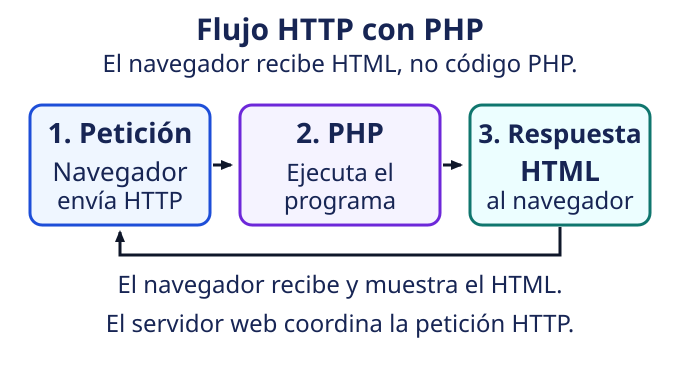
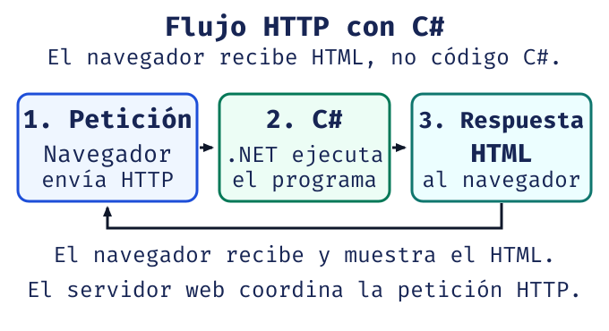
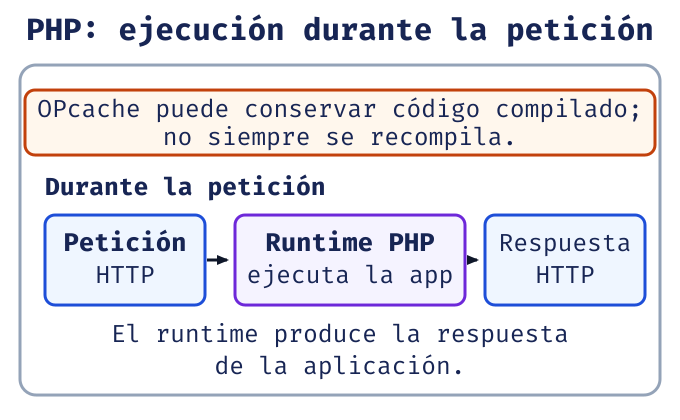
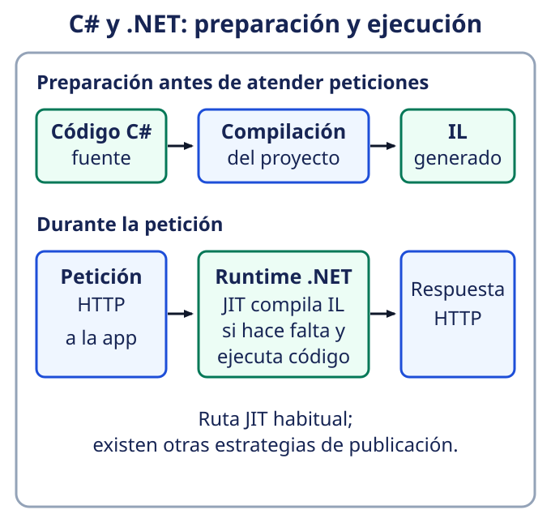

# Clase 1: de una petición a una respuesta

**Meta:** entender qué pide el navegador, qué ejecuta el servidor y qué recibe el usuario.

## Qué es una página estática o dinámica

Una página **estática** entrega un contenido ya preparado. Una página **dinámica**
construye la respuesta al recibir una petición: puede usar datos, parámetros o reglas.
No necesita una base de datos para ser dinámica.

**Para qué sirve distinguirlas:** permite saber si hay que cambiar un archivo o la
lógica que genera su contenido.

## Cómo viaja una petición

1. El navegador pide una ruta mediante HTTP: envía método, cabeceras y, a veces, datos.
2. El servidor busca el recurso o ejecuta la aplicación.
3. Devuelve un estado, cabeceras y un cuerpo, por ejemplo HTML.
4. El navegador interpreta el HTML y pide los recursos adicionales que necesita.

**El navegador recibe el resultado, no el código PHP o C# que lo generó.**

{fig-alt="Flujo PHP: el navegador pide, PHP ejecuta el programa en el servidor y devuelve HTML."}

{fig-alt="Flujo C#: el navegador pide, .NET ejecuta el programa C# en el servidor y devuelve HTML."}

### Qué indica el estado HTTP

| Estado | Significado |
|---|---|
| `200 OK` | La petición se atendió correctamente; no garantiza que el contenido sea útil. |
| `404 Not Found` | No se encontró el recurso solicitado. |
| `500 Internal Server Error` | El servidor encontró un fallo interno al atender la petición. |

**Comprueba:** en las herramientas del navegador, abre la pestaña de red y revisa
la URL, el método, el estado y el cuerpo. No te guíes solo por lo que muestra la página.

## Qué hace cada herramienta

| Elemento | Responsabilidad |
|---|---|
| HTML | Define la estructura de la página. |
| CSS | Define su presentación. |
| JavaScript | Puede modificar la página en el navegador. |
| PHP o C# | Ejecutan la lógica del servidor y pueden generar HTML o datos. |
| Editor | Permite escribir y organizar archivos; no ejecuta por sí solo la aplicación. |
| Runtime | Ejecuta el programa. |
| Servidor web | Recibe peticiones HTTP y puede delegarlas al runtime. |

## PHP y C#: lenguaje no es plataforma

**PHP** es un lenguaje cuyo runtime ejecuta la aplicación. OPcache puede guardar
código compilado para reutilizarlo [@php-manual].

**C#** es un lenguaje; **.NET** es la plataforma que aporta runtime, bibliotecas y
herramientas. En la ruta habitual, C# se compila a código intermedio (IL) y el runtime
usa JIT cuando hace falta ejecutarlo [@microsoft-csharp].

Ambos pueden producir la misma respuesta HTTP: cambia cómo preparan y ejecutan el programa.

{fig-alt="Ruta de ejecución de PHP: el runtime ejecuta la aplicación y OPcache puede conservar código compilado."}

{fig-alt="Ruta de ejecución de C#: el proyecto se compila a IL y el runtime .NET usa JIT cuando hace falta."}

### Ejemplo mínimo: saludar a Ada

En PHP:

```php
<?php
$nombre = "Ada";
echo "Hola $nombre";
```

En C#, dentro de una ruta de una aplicación ASP.NET Core:

```csharp
var nombre = "Ada";
app.MapGet("/saludo", () => $"Hola {nombre}");
```

**Resultado esperado del cuerpo de la respuesta en ambos casos:**

```text
Hola Ada
```

El navegador recibe `Hola Ada`, no `$nombre`, `echo` ni `MapGet`.
Los fragmentos necesitan sus respectivos entornos de servidor; no se ejecutan en este sitio estático.

## Por qué importa la versión de PHP

PHP 5 consolidó la orientación a objetos; PHP 7 mejoró rendimiento y tipos;
PHP 8.0 añadió, entre otras funciones, atributos y tipos unión. Las versiones 8.1 a
8.5 siguieron ampliando el lenguaje [@php85].

**Antes de copiar un ejemplo:** comprueba la versión instalada y la disponibilidad
de sus funciones en el manual. El código reciente puede fallar en versiones anteriores.

## Dónde va cada archivo

| Carpeta | Qué contiene |
|---|---|
| `public/` | Entrada web y archivos accesibles desde el navegador. |
| `src/` | Lógica de la aplicación, no expuesta como URL directa. |
| `views/` | Plantillas de presentación. |
| `config/` | Configuración; nunca contraseñas publicadas. |

Esta organización es una convención: no convierte por sí sola un proyecto en MVC.
No publiques secretos en `public/` ni en el repositorio.

### Cuándo usar `include` o `require`

- **`include`:** si falta el archivo, emite una advertencia y el script puede continuar.
- **`require`:** si falta, produce un error que detiene la ejecución si no se maneja.
  Úsalo para archivos indispensables.
- **`include_once` y `require_once`:** evitan cargar de nuevo el mismo archivo.

Si falla una carga, revisa la ruta; no ocultes el error [@php-manual].

## Qué separa MVC

**Modelo:** datos y reglas. **Vista:** presentación. **Controlador:** coordina la
petición [@aspnet-mvc]. Sirve para ubicar cada responsabilidad.

La factura PHP del repositorio es monolítica, no un modelo MVC. La aplicación C# usa
una plantilla MVC; eso no garantiza que toda su lógica esté bien separada.
Por ahora, identifica responsabilidades: no hace falta reestructurar las prácticas
ni estudiar Clean Architecture, otros patrones o TDD en esta clase.

## Practica: predice antes de ejecutar

1. Cambia `Ada` por `Luis` en los ejemplos. ¿Qué cuerpo debería recibir el navegador?
2. Si una ruta no existe, ¿qué estado corresponde?
3. Si la configuración es indispensable, ¿usarías `include` o `require`?

**Respuestas:** `Hola Luis`; `404 Not Found`; `require`.

**Recuerda:** el cliente pide, el servidor procesa y el cliente recibe una respuesta.

## Fuentes y trazabilidad

Temario de Clase 1: fuente curricular primaria [@blackboard-s1c1].
Detalles técnicos: [manual de PHP](https://www.php.net/manual/en/),
[PHP 8.5](https://www.php.net/releases/8.5/en.php),
[referencia de C#](https://learn.microsoft.com/en-us/dotnet/csharp/language-reference/)
y [ASP.NET Core MVC](https://learn.microsoft.com/en-us/aspnet/core/mvc/overview?view=aspnetcore-10.0).
Consulta: 2026-10-30.

## Autoevaluación de opción múltiple

Elige una alternativa y usa la retroalimentación para repasar.

<!-- quiz: web-foundations-response-body -->

<!-- quiz: web-foundations-status -->

<!-- quiz: web-foundations-dotnet -->

<!-- quiz: web-foundations-require -->

**Siguiente paso:** en la Clase 2, practica tipos, conversiones y ámbitos en PHP y C#.
