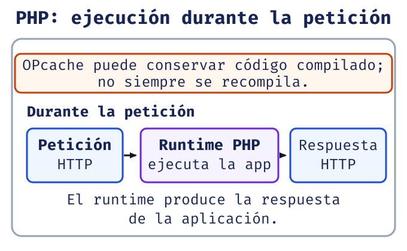

# Clase 1: de una petición a una respuesta

**Meta.** Al terminar podrás explicar qué ocurre entre un navegador y una aplicación,
y distinguir el lenguaje, la plataforma y las carpetas básicas de un proyecto.
No necesitas montar un servidor para leer esta clase: primero sigue el recorrido y
luego comprueba tus predicciones con las prácticas de la semana.

> **Ruta de estudio:** predice qué pide el navegador → sigue la respuesta → compara
> PHP y C# → nombra la responsabilidad de cada carpeta → comprueba tu explicación.

## Una página no siempre es un archivo fijo

Una página **estática** entrega esencialmente el mismo HTML a quienes solicitan la
misma URL. Sus archivos pueden vivir en un servidor, pero no requieren ejecutar
lógica para fabricar ese contenido. Una página **dinámica** se construye al atender
la petición: puede usar parámetros, datos o reglas antes de enviar la respuesta.
Dinámico no significa necesariamente complejo ni que deba incluir una base de datos.

Predicción: al escribir una dirección web y pulsar Enter, ¿el navegador recibe PHP
o C#? Normalmente recibe una **respuesta HTTP**, cuyo cuerpo puede ser HTML, CSS,
JavaScript, una imagen o datos. El código del servidor se ejecuta antes y no se
entrega como parte de la página.

{fig-alt="Dos recorridos equivalentes: petición HTTP del navegador, ejecución de PHP en el servidor y respuesta HTML de vuelta al navegador; petición HTTP del navegador, ejecución de C# mediante .NET en el servidor y respuesta HTML de vuelta al navegador. El navegador muestra el HTML, no recibe el código PHP o C#."}

## El ciclo mínimo HTTP

1. El **cliente** (por ejemplo, un navegador) envía una petición: método, ruta,
   cabeceras y, si corresponde, datos.
2. El **servidor** la recibe y el programa decide qué hacer.
3. La respuesta incluye un código de estado, cabeceras y un cuerpo.
4. El navegador interpreta el HTML recibido y solicita recursos adicionales si los
   encuentra.

Los estados no son mensajes decorativos. `200 OK` indica que la respuesta fue
atendida; `404 Not Found` comunica que no se encontró el recurso solicitado; `500
Internal Server Error` señala un fallo no controlado del lado servidor. Un `200` no
garantiza que el contenido sea útil, y un `404` no prueba por sí solo que el programa
esté roto: expresa el resultado de esta petición.

::: {.callout-note}
## Observa antes de concluir

Las herramientas de desarrollo del navegador permiten ver URL, método, estado y
cuerpo de una respuesta. Es una comprobación mejor que deducir el resultado solo por
lo que parece mostrar la pantalla.
:::

## HTML en el cliente; programas en el servidor

HTML describe la estructura que el navegador renderiza. CSS presenta esa estructura
y JavaScript puede modificarla en el cliente. PHP y C# pueden generar HTML o datos
en el servidor. Esta división ayuda a diagnosticar: si el navegador muestra una
etiqueta literalmente, probablemente llegó como texto; si aparece un error de PHP o
.NET, la ejecución ocurrió en el servidor.

No confundas «usar un editor» con «ejecutar una aplicación». Un **editor** escribe y
organiza archivos. El **runtime** interpreta o ejecuta el programa. Un **servidor
web** recibe HTTP y puede delegar la petición al runtime. En desarrollo pueden estar
en el mismo equipo; sus funciones siguen siendo distintas.

::: {.table-responsive tabindex="0" role="region" aria-label="Comparación de editor, runtime y servidor web"}

| Pregunta | Editor | Runtime | Servidor web |
|---|---|---|---|
| ¿Escribe `index.php` o `Program.cs`? | Sí | No | No |
| ¿Ejecuta el lenguaje? | No | Sí | Coordina o delega |
| ¿Acepta una petición HTTP? | No | No necesariamente | Sí |

:::

## PHP y C#: comparación inicial

PHP es un lenguaje usado con frecuencia para generar respuestas web. En el flujo
tradicional, el runtime evalúa el archivo PHP que corresponde a la petición. Un
acelerador como OPcache puede conservar código compilado en memoria, por lo que no es
correcto afirmar que PHP «siempre recompila todo» en cada solicitud [@php-manual].

C# es el **lenguaje** con el que escribimos el programa. .NET es la **plataforma**
que ofrece runtime, bibliotecas y herramientas para compilar y ejecutar ese programa.
Al compilar, C# produce código intermedio (IL); el runtime aplica compilación JIT
cuando necesita ejecutar código. Es una comparación de rutas de ejecución, no una
escala de calidad: la elección depende del contexto y del proyecto [@microsoft-csharp].

{fig-alt="Ruta PHP con ejecución en su runtime y contexto de OPcache. Ruta C# con compilación previa a IL y ejecución mediante el runtime .NET, que aplica JIT cuando necesita ejecutar código."}

### Ejemplo mental emparejado

Supón que una ruta debe saludar a Ada. En PHP el runtime evalúa una instrucción que
produce `Hola Ada`; en C#, la aplicación compilada ejecuta una instrucción equivalente
y produce el mismo texto. En ambos casos el resultado puede insertarse en una
respuesta HTTP. Predice cuál parte ve el navegador: ve el texto final, no la variable
ni el paso de compilación.

**Por qué importa.** Si cambias HTML, estás cambiando lo que el cliente interpreta.
Si cambias PHP o C#, estás cambiando cómo el servidor construye la respuesta. Para
confirmarlo, inspecciona la respuesta en el navegador y observa que no contiene el
código de servidor.

## Una historia breve de PHP

La evolución importa porque explica por qué encontrarás proyectos con estilos
diferentes. PHP 5 consolidó gran parte del modelo orientado a objetos; PHP 7 trajo
mejoras importantes de rendimiento y tipos; PHP 8.0 incorporó cambios de lenguaje
como atributos y unión de tipos. Las versiones 8.1 a 8.3 continuaron refinando el
lenguaje, y PHP 8.4 y 8.5 son versiones posteriores documentadas por el proyecto.
Esta clase no es un tutorial de sus novedades: al trabajar en un repositorio, verifica
la versión real antes de usar una característica [@php85].

La versión activa es una condición técnica, no un detalle de estilo. Una instrucción
válida en una versión reciente puede no funcionar en una instalación anterior.
Consulta las notas oficiales de PHP 8.5 y el manual para confirmar disponibilidad, en
vez de copiar fragmentos aislados [@php85; @php-manual].

## Carpetas: pistas sobre responsabilidades

Un punto de partida frecuente separa estas carpetas:

| Carpeta | Responsabilidad inicial |
|---|---|
| `public/` | Punto expuesto al navegador: archivos públicos y entrada web. |
| `src/` | Código de la aplicación que no debería ser una URL directa. |
| `views/` | Plantillas o fragmentos destinados a producir la presentación. |
| `config/` | Configuración de la aplicación, no secretos publicados. |

Esta convención no es una ley del lenguaje ni convierte automáticamente un proyecto
en MVC. Es una forma de hacer visible qué archivo está expuesto y dónde buscar una
responsabilidad. Nunca publiques contraseñas en `public/` ni en un repositorio.

PHP ofrece `include` y `require` para incorporar archivos. Si falta un archivo,
`include` emite una advertencia y el script puede continuar; `require` produce un
error fatal y detiene la ejecución. Para configuración o código indispensable,
`require` evita continuar con una aplicación incompleta. Comprueba la ruta y el
mensaje; no silencies el problema con operadores de supresión [@php-manual].

## MVC: una introducción, no una receta completa

MVC propone separar responsabilidades: un **modelo** representa datos y reglas, una
**vista** presenta información y un **controlador** coordina una petición. ASP.NET
Core MVC documenta este patrón para aplicaciones web [@aspnet-mvc]. En Semana 1 basta
con reconocer el propósito de esa separación y no colocar una decisión de interfaz en
un lugar arbitrario.

El ejemplo de factura PHP existente en el repositorio es monolítico y **no** es una
arquitectura MVC de referencia. La aplicación C# ya usa una plantilla MVC, pero eso
no convierte toda su lógica de negocio en un catálogo de patrones de dominio. No
reestructures esas prácticas durante este repaso: observa, nombra responsabilidades y
avanza gradualmente.

::: {.callout-important}
## Límite de Semana 1

Patrones de diseño, Clean Architecture y TDD requieren práctica deliberada posterior.
Aquí no abrimos capítulos nuevos sobre ellos: usamos solo la idea inicial de separar
responsabilidades para leer mejor una aplicación MVC.
:::

## Fuentes y trazabilidad

El temario de Clase 1 es la fuente curricular primaria [@blackboard-s1c1]. Para
confirmar detalles técnicos consulta el [manual oficial de PHP](https://www.php.net/manual/en/),
las [notas de PHP 8.5](https://www.php.net/releases/8.5/en.php), la
[referencia de C#](https://learn.microsoft.com/en-us/dotnet/csharp/language-reference/)
y la [introducción oficial a ASP.NET Core MVC](https://learn.microsoft.com/en-us/aspnet/core/mvc/overview?view=aspnetcore-10.0).
Consulta: 2026-10-30.

## Autoevaluación manual

1. ¿Qué diferencia práctica hay entre el cuerpo de una respuesta HTTP y el código PHP?
2. ¿Por qué `404` y `500` describen situaciones distintas?
3. ¿Qué distingue a C# de .NET cuando explicas cómo se ejecuta un programa?
4. ¿Cuándo prefieres `require` a `include` y por qué?

::: {.callout-note collapse="true" title="Retroalimentación razonada"}

1. El navegador recibe el cuerpo de la respuesta; PHP se ejecutó antes en el servidor.
2. `404` comunica que no se encontró el recurso; `500` indica un error interno al
   procesar la solicitud. Ambos se verifican en la respuesta, no solo en la página.
3. C# es el lenguaje; .NET aporta runtime y bibliotecas que ejecutan IL mediante JIT.
4. Cuando el archivo es indispensable, porque detenerse revela una aplicación incompleta
   en vez de continuar con un estado incierto.
:::

**Siguiente paso:** en la Clase 2 predice tipos, conversiones y ámbitos antes de
confirmarlos con los dos programas de demostración.
