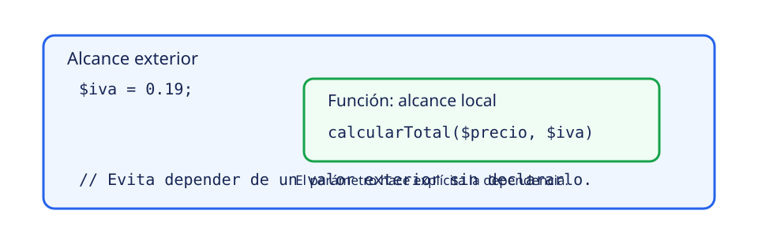

# Clase 2: valores, tipos y alcance

**Meta.** Declararás valores con intención, anticiparás una conversión y explicarás
qué nombre está disponible en cada parte del programa. La meta no es memorizar una
lista: es predecir, ejecutar y justificar el resultado en PHP y C#.

> **Ciclo de estudio:** identifica el valor → predice el tipo y el alcance → compara
> ambos lenguajes → ejecuta el ejemplo → explica cualquier diferencia.

## Un nombre apunta a un valor

Una variable asocia un nombre con un valor que puede cambiar. El nombre debe describir
el dato (`$total`, `nombreCliente`) y respetar las reglas del lenguaje. PHP distingue
mayúsculas y minúsculas en los nombres de variables: `$total` y `$Total` no son el
mismo nombre. C# también distingue `total` de `Total`; por convención suele usar
`camelCase` para variables locales y `PascalCase` para constantes y miembros.

En PHP una variable empieza con `$`:

```php
$nombre = 'Ada';
$activo = true;
```

En C# se declara primero el tipo o se permite que `var` lo infiera:

```csharp
string nombre = "Ada";
bool activo = true;
var edad = 20;
```

`var` **no** hace dinámico a C#. El compilador infiere un tipo estático a partir del
valor inicial; `edad` sigue siendo `int` y no puede recibir luego una cadena. PHP
trabaja habitualmente con tipado dinámico: una variable puede contener valores de
tipos diferentes en momentos distintos. Esa flexibilidad no elimina la necesidad de
leer conversiones y contratos con cuidado [@microsoft-csharp; @php-manual].

## Tipos escalares y colecciones iniciales

Empieza por cuatro tipos escalares frecuentes: enteros, números de punto flotante,
cadenas y booleanos. PHP también tiene `null`, que expresa ausencia de valor. C# usa
`null` para referencias anulables; con tipos de valor, `int?` representa un entero que
puede ser nulo. Activa y respeta las advertencias de nulabilidad: no son una garantía
absoluta, pero señalan rutas que podrían fallar.

| Idea | PHP | C# |
|---|---|---|
| Entero | `3` | `int cantidad = 3;` |
| Decimal | `3.5` | `double precio = 3.5;` |
| Cadena | `'Ada'` o `"Ada"` | `string nombre = "Ada";` |
| Booleano | `true` | `bool activo = true;` |
| Ausencia | `null` | `string? apodo = null;` |

Un array de PHP puede actuar como lista o como mapa de claves. En C# conviene nombrar
la colección por su intención; para comenzar, un arreglo como `string[] nombres =
["Ada", "Lin"];` almacena elementos del mismo tipo. No conviertas esta introducción
en una taxonomía de colecciones: primero reconoce qué datos contiene cada ejemplo.

## Comillas e interpolación

En PHP las comillas simples preservan el texto: `'Hola $nombre'` no reemplaza la
variable. Las dobles permiten interpolación: `"Hola {$nombre}"`. Las llaves aclaran el
límite del nombre y evitan ambigüedades al rodearlo de texto.

C# usa comillas dobles para `string` y antepone `$` para interpolar:

```csharp
string nombre = "Ada";
string saludo = $"Hola {nombre}";
```

Predice el resultado de los dos fragmentos antes de ejecutarlos. En PHP, una comilla
simple muestra `$nombre` literalmente; en C#, sin el prefijo `$`, `{nombre}` también
es texto ordinario. La interpolación mejora legibilidad cuando es sencilla; no sustituye
validar ni codificar datos según el contexto donde se usarán.

## Constantes: lo que no debe cambiar

Una constante comunica que un valor no cambia durante el programa. En PHP, `const`
se declara como parte del código y `define()` crea una constante en tiempo de
ejecución. Para una constante conocida y simple, prefiere `const` por claridad:

```php
const CURSO = 'PHP-CSharp';
define('ETIQUETA', 'Semana 1');
```

En C#, `const` requiere un valor de compilación. `readonly` es diferente: permite
asignar el campo en su declaración o en el constructor y después impide modificarlo.
Por tanto, `readonly` **no** equivale a una constante de tiempo de compilación.

```csharp
const string Curso = "PHP-CSharp";
static readonly DateTime Inicio = DateTime.UtcNow;
```

Usa `const` cuando el valor pertenece literalmente al código y `readonly` cuando el
valor se fija al construir o inicializar el objeto. No uses ambos solo por estilizar:
la diferencia afecta dónde y cuándo puede asignarse el valor [@microsoft-csharp].

## Conversión: predice antes de sumar

Una conversión implícita ocurre cuando el lenguaje puede usar un valor como otro tipo
sin sintaxis adicional; una explícita declara la intención. En C#, convertir `double`
a `int` exige una conversión explícita porque puede perder decimales:

```csharp
double precio = 3.9;
int truncado = (int)precio; // 3
```

En PHP también puedes convertir explícitamente, por ejemplo `(int) '3'`. Antes de
hacerlo, pregúntate si el texto realmente representa un número y valida la entrada
externa. Convertir no es corregir datos desconocidos.

### Ejemplo emparejado: texto y número

**Predice.** ¿Qué sale al combinar la cadena numérica `'3'` con el número `3`?

```php
$resultado = '3' + 3;
// $resultado es 6
```

PHP convierte esta cadena numérica para la operación aritmética y obtiene `6`. En C#,
`+` con una cadena realiza concatenación:

```csharp
string resultado = "3" + 3;
// resultado es "33"
```

**Por qué.** Los operadores se interpretan junto con los tipos de sus operandos. No
copies una expresión de un lenguaje al otro suponiendo igual significado. La cadena
no numérica `'3a'` puede producir una advertencia o un comportamiento problemático en
PHP al usarla como número; no es una técnica recomendada ni un dato de prueba válido.
Valida y convierte de forma explícita antes de calcular [@php-manual].

**Comprobación de error.** Si esperabas `6` en C#, convierte el texto validado a un
número antes de sumar. Si recibes texto externo en PHP, verifica su formato antes de
aplicar `+`; no ocultes advertencias para forzar un resultado.

## Alcance: dónde existe un nombre

El alcance responde «¿en qué parte del código puedo usar este nombre?». Una variable
local existe dentro de la función o método que la declara. Los parámetros son una
forma explícita de entregar valores a esa función; por eso son preferibles a depender
de variables globales.

{fig-alt="Comparación del alcance de una variable exterior, una variable de bloque y el parámetro local de una función."}

*Figura 3. Un nombre es visible solo dentro de su ámbito; pasar un parámetro deja la
dependencia a la vista.*

PHP no crea un nuevo ámbito de variable solo por usar llaves de un `if` o bloque. C#
sí delimita variables declaradas dentro de un bloque. Compara estas dos intenciones:

```php
$exterior = 10;
{
    $enBloque = 7;
}
echo $enBloque; // visible: PHP no crea ámbito de bloque
```

```csharp
int exterior = 10;
{
    int enBloque = 7;
}
// Console.WriteLine(enBloque); // error: ya salió del bloque
```

No pruebes el error de C# descomentándolo en la demostración ejecutable: se conserva
compilable para que puedas verificar sus resultados. El contraste se explica mejor
cuando primero predices y luego reconoces que el compilador evita ese acceso.

En PHP, una función no toma una variable global automáticamente. `global $exterior;`
la hace accesible, pero oculta una dependencia. Es más claro recibir `$exterior` como
parámetro. En C#, evita el estado global mutable por la misma razón: los parámetros
y retornos muestran qué necesita y qué produce una operación.

### Variable `static` en PHP

Una variable local `static` conserva su valor entre llamadas a la **misma función
durante la petición actual**. No es una memoria compartida y no debe describirse como
un contador entre solicitudes HTTP. Cada petición puede iniciar un proceso o contexto
distinto; para datos entre peticiones se necesita un mecanismo explícito que no forma
parte de esta clase.

C# también puede tener campos `static` asociados al tipo. El ejemplo usa uno para
mostrar dos llamadas consecutivas en el mismo proceso de consola, no para prometer
persistencia entre reinicios ni entre usuarios web.

## Ejecuta y contrasta las demostraciones

Estos programas pequeños ilustran constantes, alcance y la diferencia de `+`. No son
una práctica web MVC ni reemplazan la práctica de HTML/CSS/PHP de Semana 1.

Desde la raíz del repositorio, ejecuta PHP:

```bash
php ebook/examples/week1/php/variables.php
```

Salida esperada, sin advertencias:

```text
CONST|curso=PHP-CSharp|etiqueta=Semana 1
SCOPE|bloque=7|exterior=10|static=1,2
STRING|interpolacion=Hola Ada|suma=6
```

Para C# se usa el proyecto de consola .NET 10. Desde una copia nueva del repositorio,
construye primero la imagen pública definida en `csharp/Dockerfile`:

```bash
docker compose -f csharp/compose.yaml build app
```

Este paso crea `csharp-app:latest` con el nombre de proyecto predeterminado de Compose.
Solo construye la imagen: no inicia la aplicación ni SQL Server. Requiere conexión
para descargar la imagen base y sus herramientas. Con esa imagen ya disponible,
el comando aislado es:

```bash
docker run --rm --network none --entrypoint sh -v "$PWD/ebook/examples/week1/csharp:/source:ro" csharp-app:latest -c 'mkdir /work && cp -a /source/. /work/ && cd /work && dotnet run --project Week1.csproj --configuration Release --no-launch-profile'
```

Su salida esperada es deliberadamente igual salvo la concatenación:

```text
CONST|curso=PHP-CSharp|etiqueta=Semana 1
SCOPE|bloque=7|exterior=10|static=1,2
STRING|interpolacion=Hola Ada|suma=33
```

Las aserciones internas detienen el programa si cambian estos contratos. Si una salida
difiere, revisa primero comillas, tipo y ámbito; no atribuyas la diferencia a MVC ni a
una petición HTTP porque estos son programas de consola.

## Fuentes y límites

El contenido curricular proviene de Clase 2 [@blackboard-s1c2]. Para detalles de
lenguaje consulta el [manual oficial de PHP](https://www.php.net/manual/en/) y la
[referencia oficial de C#](https://learn.microsoft.com/en-us/dotnet/csharp/language-reference/).
Consulta: 2026-10-30. Temas como patrones, Clean Architecture y TDD se retomarán solo
cuando una semana posterior los requiera; aquí la prioridad es dominar valores y
alcance observables.

## Autoevaluación manual

1. ¿Por qué `var` no transforma una variable de C# en dinámica?
2. Predice `"Hola $nombre"` y `'Hola $nombre'` en PHP cuando `$nombre` vale `Ada`.
3. ¿Qué resultado producen `'3' + 3` en PHP y `"3" + 3` en C#? Explica la causa.
4. ¿Qué diferencia a `readonly` de `const` en C#?
5. ¿Por qué un parámetro suele ser preferible a leer una variable global?

::: {.callout-note collapse="true" title="Pistas progresivas y retroalimentación razonada"}

- **Pista 1:** separa «cómo se infiere el tipo» de «cuándo puede cambiar».
- **Pista 2:** mira primero qué comillas habilitan sustitución en PHP.
- **Pista 3:** observa si `+` recibe dos números o una cadena.

`var` infiere un tipo estático en la compilación. Las dobles de PHP producen `Hola
Ada`; las simples dejan el nombre literal. PHP suma la cadena numérica y obtiene `6`;
C# concatena y obtiene `33`. `readonly` puede asignarse al inicializar o construir,
mientras que `const` debe conocerse en compilación. Un parámetro declara la
entrada de la operación y reduce dependencias ocultas.
:::

**Siguiente paso:** usa estas predicciones al revisar la práctica de Semana 1 y anota
qué resultado observaste antes de consultar una solución.
