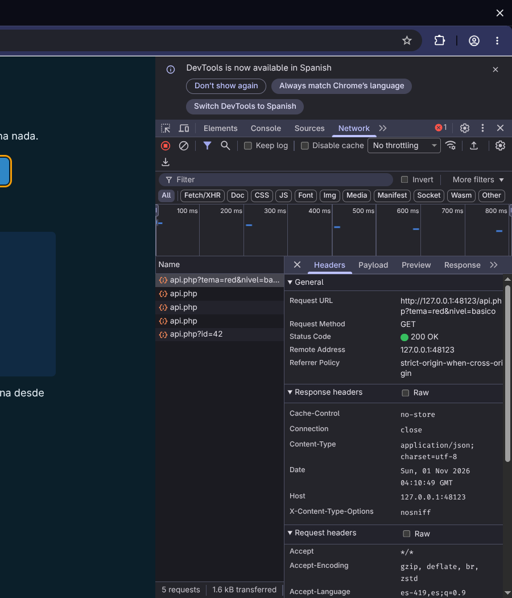
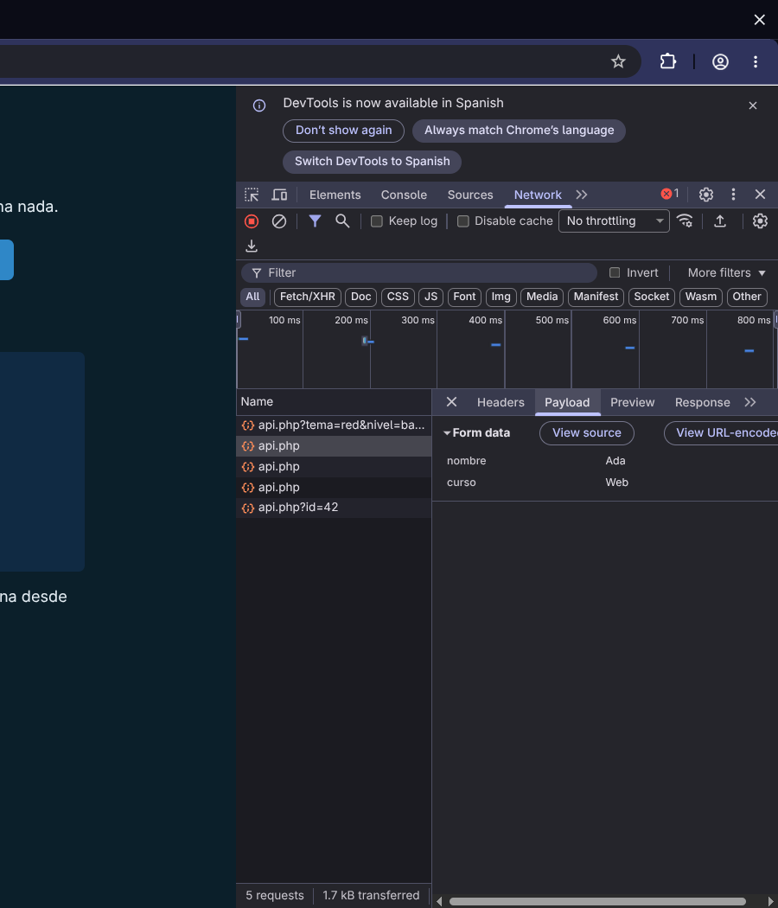
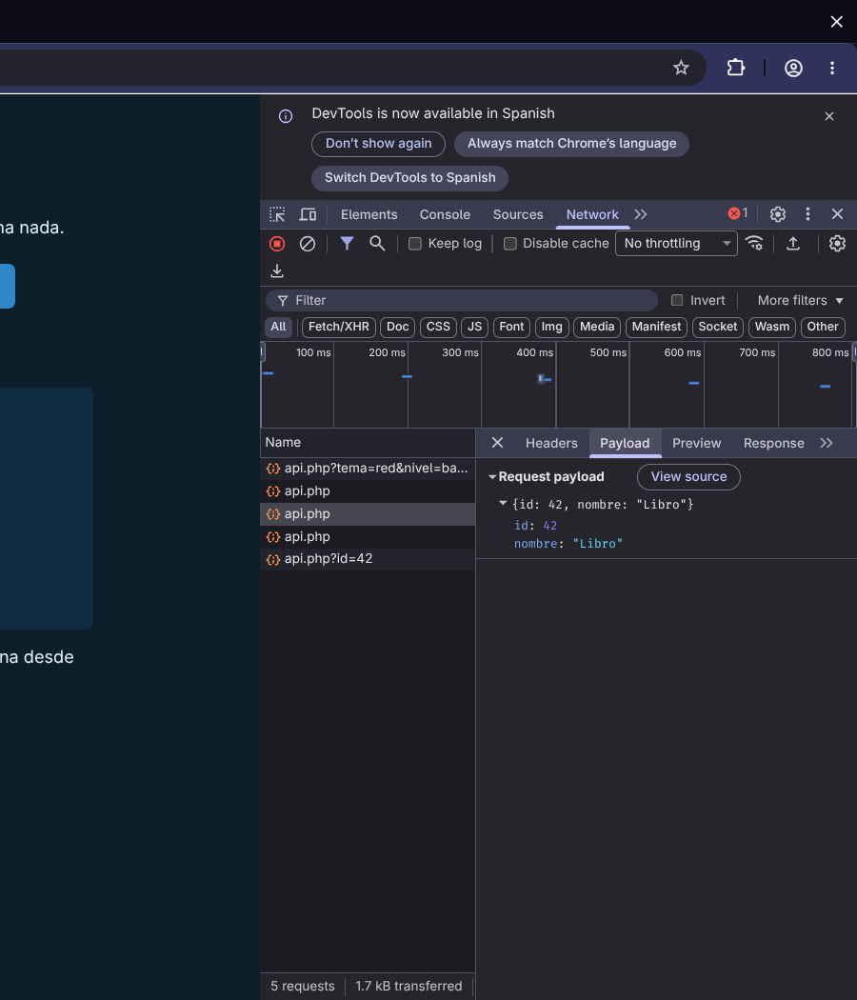
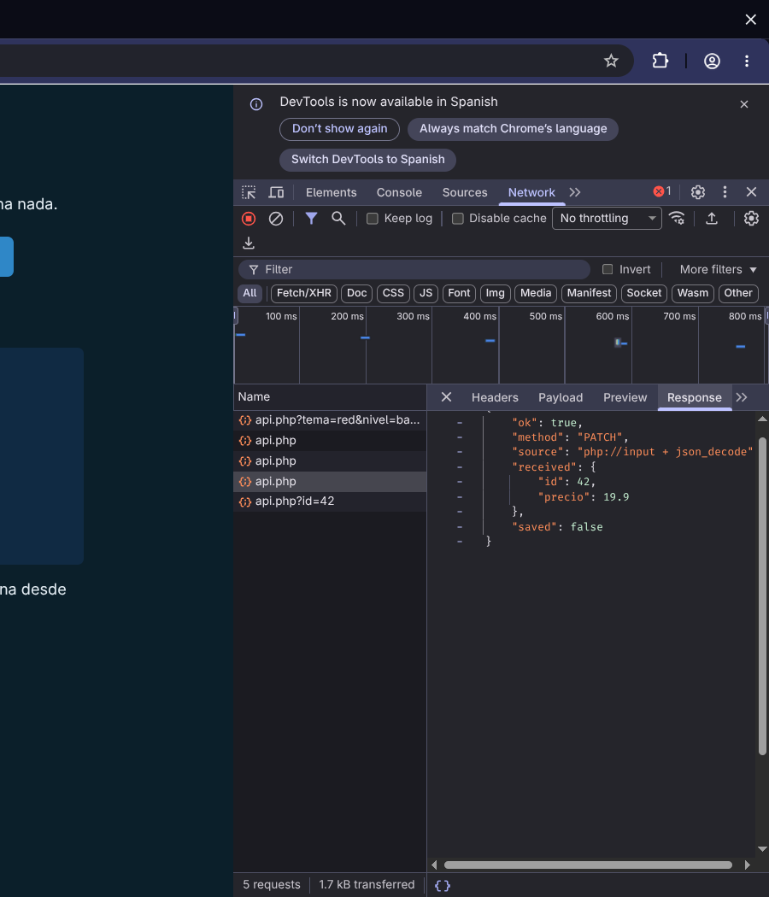
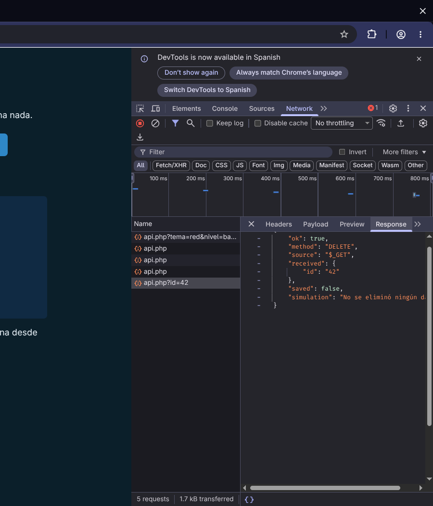

# Laboratorio PHP: cinco métodos en DevTools

Este laboratorio transversal permite observar peticiones reales a un servidor PHP local. Practicarás `GET`, `POST`, `PUT`, `PATCH` y `DELETE` sin base de datos ni persistencia: todos los datos son ficticios y **DELETE solo simula** una eliminación.

## Ruta rápida

Necesitas PHP instalado. Desde la raíz del repositorio ejecuta:

```bash
php -S 127.0.0.1:8088 -t ebook/examples/http-methods ebook/examples/http-methods/router.php
```

Después abre [el laboratorio local](http://127.0.0.1:8088/). La [guía del ejemplo](../../examples/http-methods/README.md) conserva el mismo comando y sirve como referencia descargable del código fuente.

::: {.callout-warning}
Usa exactamente `127.0.0.1`, el document root aislado `ebook/examples/http-methods` y `router.php`, que limita las rutas públicas. No omitas el router, no uses `0.0.0.0` ni sirvas la raíz del repositorio: podrías exponer otros archivos. El ejemplo requiere PHP local; no funciona con `file://` ni ejecutado desde GitHub Pages.
:::

## Abrir y preparar Network

1. Abre DevTools con `F12`, `Ctrl+Shift+I` o el menú del navegador.
2. Selecciona **Network** o **Red**. Si no aparece, búscala en `»`.
3. Filtra por `api.php`. Activa **Preserve log / Conservar registro** si quieres mantener las cinco filas.
4. Pulsa un botón del laboratorio y selecciona la nueva fila.
5. Revisa **Headers**, **Payload** y **Response**. Los nombres pueden variar ligeramente según la versión o el idioma del navegador.

En **Headers → General** identifica siempre **Request URL**, **Request Method** y **Status Code**. Luego relaciona lo observado con la fuente que PHP leyó y con el JSON de respuesta.

## GET: parámetros en la URL

Pulsa **GET con query**. En la URL aparecen `tema=red` y `nivel=basico`; DevTools también puede mostrarlos como **Query String Parameters**. PHP los recibe en `$_GET`.

{#fig-http-lab-get fig-alt="DevTools Network unido al laboratorio PHP real: la fila GET seleccionada muestra Request URL, Request Method GET, Status Code 200 y la dirección loopback." fig-cap="GET real: URL, método y estado en Headers; las cinco filas corresponden al mismo laboratorio PHP local." width="100%"}

## POST: formulario

Pulsa **POST formulario** y abre **Payload**. El navegador envía `application/x-www-form-urlencoded`; por eso DevTools presenta **Form data** y PHP llena `$_POST`. La query, si existiera, seguiría perteneciendo a `$_GET`.

{#fig-http-lab-post fig-alt="DevTools Network unido al laboratorio PHP real: Payload de POST muestra Form data con nombre Ada y curso Web." fig-cap="POST real: datos de formulario visibles en Payload y disponibles en `$_POST`." width="100%"}

## PUT: cuerpo JSON completo de ejemplo

Pulsa **PUT JSON**. DevTools muestra el **Request payload** `{id: 42, nombre: "Libro"}`. PHP no coloca este JSON en `$_POST`: el endpoint lee `php://input` y luego usa `json_decode`.

{#fig-http-lab-put fig-alt="DevTools Network unido al laboratorio PHP real: Payload de PUT muestra el JSON con id 42 y nombre Libro." fig-cap="PUT real: JSON enviado como Request payload y leído desde `php://input`." width="100%"}

## PATCH: cambio parcial

Pulsa **PATCH JSON**. El cuerpo contiene solo el identificador y el precio de ejemplo. En **Response**, PHP confirma el método, la fuente `php://input + json_decode`, los datos recibidos y `saved: false`: observar una respuesta correcta no implica que se haya guardado algo.

{#fig-http-lab-patch fig-alt="DevTools Network unido al laboratorio PHP real: Response de PATCH muestra method PATCH, el origen php input más json decode, precio 19.9 y saved false." fig-cap="PATCH real: la respuesta confirma la entrada JSON y que el laboratorio no persiste datos." width="100%"}

## DELETE: simulación explícita

Pulsa **DELETE simulado**. El identificador viaja como query y PHP lo obtiene de `$_GET`. La respuesta dice `saved: false` y `simulation: "No se eliminó ningún dato."`; no existe archivo, registro o contador que borrar.

{#fig-http-lab-delete fig-alt="DevTools Network unido al laboratorio PHP real: Response de DELETE muestra method DELETE, id 42, saved false y el mensaje de simulación sin eliminación." fig-cap="DELETE real como petición HTTP, pero con efecto simulado y sin eliminación de datos." width="100%"}

## Qué debes poder explicar

| Observación | Lectura razonada |
|---|---|
| URL, método y estado | Identifican el destino, la intención de la petición y el resultado HTTP. |
| Query String Parameters | Se originan en la URL y llegan a `$_GET`, no solo cuando el método es GET. |
| Form data de POST | PHP lo procesa en `$_POST` para el tipo de formulario usado. |
| Request payload JSON | PHP debe leer `php://input`, decodificar y validar el formato. |
| Response | Es el cuerpo que emitió PHP; aquí refleja entradas ficticias sin guardarlas. |

Detén el servidor con `Ctrl+C` al terminar. Para recordar significados, idempotencia y estados, vuelve a [Tablas de consulta HTTP](consulta-http.qmd).
