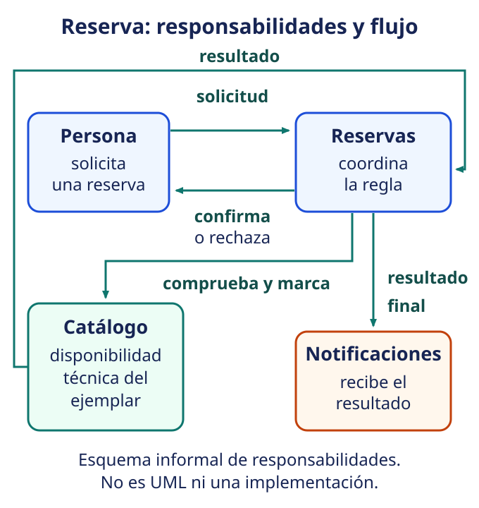

# Diseño y arquitectura: de la necesidad a las decisiones

**Meta.** Al terminar podrás pasar de una necesidad a una decisión de diseño,
explicar por qué importa y proponer cómo observar su resultado. La arquitectura
no empieza al dibujar cajas: empieza al hacer explícitas decisiones que condicionan
cómo el sistema responderá a cambios y cualidades relevantes [@blackboard-arq-s1].

## Objetivos de aprendizaje

- Distinguir análisis, diseño y arquitectura sin reducirlos a una escala de tamaño.
- Usar abstracción, modularidad, encapsulación, acoplamiento y cohesión al razonar.
- Reconocer vistas, relaciones, estilos y atributos de calidad iniciales.

**Pregunta de recuperación.** Si dos módulos cambian juntos cada vez que cambia una
regla, ¿qué hipótesis harías sobre su frontera y por qué?

## De entender la necesidad a decidir una forma

El **análisis** pregunta qué problema, actores, reglas y resultados importan: por
ejemplo, una biblioteca necesita reservar ejemplares sin prometer dos veces el mismo
libro. El **diseño** decide cómo organizar una solución a ese problema. La
**arquitectura** reúne las decisiones de diseño de alto impacto —componentes,
interfaces, datos, despliegue y restricciones— y su justificación.

Hay solapamiento: una decisión puede ser arquitectónica en un contexto y local en
otro. No existe un corte correcto de «muchas líneas = arquitectura». Elegir una
interfaz que consumen varios equipos suele tener más alcance que renombrar una
función, aunque la primera sea breve. La pregunta útil es qué opciones habilita o
cierra la decisión y quién deberá convivir con ella.

## Separar para comprender y cambiar

Una **abstracción** conserva lo esencial y oculta detalle accidental: `Reserva`
representa una intención, no cada tabla de la base de datos. La **modularidad**
agrupa responsabilidades para que puedan comprenderse y modificarse con cierta
independencia. La **encapsulación** protege el estado y las reglas detrás de una
interfaz; no es solo declarar campos privados.

Dos medidas cualitativas orientan la conversación. El **acoplamiento** es cuánto
necesita saber o depender una parte de otra: se prefiere bajo cuando evita cambios
en cascada. La **cohesión** expresa cuán relacionadas están las tareas dentro de un
módulo: se prefiere alta cuando una razón clara explica por qué viven juntas. Son
objetivos de diseño, no números mágicos. La ocultación de decisiones propensas a
cambiar es una razón histórica para fijarse en esas fronteras [@parnas1972].

El diseño **estructurado** suele descomponer por procesos y transformaciones de
datos; el **orientado a objetos** organiza colaboraciones entre objetos con estado y
comportamiento. Ninguno anula el otro: un sistema OO también tiene flujos y datos,
y uno estructurado puede tener módulos bien delimitados. Se elige la representación
que hace más visible el problema.

## Vistas que responden preguntas distintas

| Vista | Pregunta que aclara | Ejemplo en reservas |
|---|---|---|
| Conceptual | ¿Qué conceptos y reglas existen? | ejemplar, persona, reserva y disponibilidad |
| Lógica | ¿Qué componentes colaboran? | catálogo, reservas y notificaciones |
| Física | ¿Dónde se ejecutan y guardan? | navegador, servicio y base de datos |

Un diagrama de **casos de uso** sitúa a la persona usuaria y metas como «reservar»;
un diagrama de **clases** propone conceptos, atributos y relaciones; uno de
**secuencia** muestra mensajes en un escenario. Son notaciones para comunicar, no
una garantía de que el diseño sea bueno. Un patrón nombra una solución recurrente
con sus consecuencias; la documentación registra contexto, decisión, alternativas
y razón para que no haya que adivinarla después.

{fig-alt="Mapa conceptual accesible: una persona solicita una reserva; Reservas consulta la disponibilidad en Catálogo y devuelve confirmación o rechazo. Las interfaces conectan los módulos."}

*Figura 1. Mapa conceptual de responsabilidades e interfaces para conversar sobre
una reserva; es un esquema informal, no un diagrama UML formal.*

## Caso guiado: reservar sin duplicar una promesa

**Necesidad de calidad.** Cuando dos personas intentan reservar el mismo ejemplar,
el sistema debe evitar confirmar ambas reservas. La calidad aquí es consistencia de
la operación y la confiabilidad de la información. No debe confundirse la
disponibilidad de un ejemplar con la disponibilidad del servicio; no es un benchmark medido.

**Decisión.** El módulo `Reservas` expone `solicitar(ejemplar, persona)` y delega a
la interfaz `Disponibilidad` una operación atómica de comprobar y marcar. El módulo
`Notificaciones` recibe solo el resultado final. Así la regla de no duplicación queda
encapsulada, y la interfaz evita que una pantalla modifique el inventario por su
cuenta.

**Comprobación observable propuesta.** En una prueba controlada con dos solicitudes
para el mismo ejemplar disponible, se espera una confirmación y un rechazo; el
registro debe mostrar una sola reserva activa. Es un criterio hipotético para discutir
la decisión, no una rúbrica docente ni una medición de rendimiento.

## Estilos y cualidades: opciones con consecuencias

Cliente-servidor separa quien solicita de quien presta un servicio. Capas organizan,
por ejemplo, presentación, reglas y persistencia. Un monolito puede mantener esos
límites dentro de un único despliegue; microservicios los distribuyen entre servicios
independientes. Se pueden combinar: un monolito por capas puede atender clientes, y
un conjunto de servicios también puede usar capas. Microservicios no son un ascenso
automático ni una cura para un diseño poco claro.

| Atributo | Pregunta inicial | Decisión que podría influir |
|---|---|---|
| Rendimiento | ¿cuánto tarda una reserva bajo una carga definida? | consulta e índices adecuados |
| Seguridad | ¿quién puede reservar o administrar? | autorización en la interfaz |
| Escalabilidad | ¿qué crece y cómo se distribuye? | separar trabajo repetible si se justifica |
| Disponibilidad | ¿qué ocurre si falla un componente? | manejo explícito de fallos y degradación planificada |
| Mantenibilidad y reutilización | ¿dónde cambia una regla? | módulos cohesivos e interfaces estables |

No hay un estilo mejor sin contexto, restricciones y evidencia. Tampoco conviene
partir en microservicios antes de conocer las fronteras, la operación y el coste de
coordinar despliegues, fallos y datos.

## Ejercicio breve

Una pantalla consulta directamente la base de datos y manda correos de confirmación.
Propón una frontera de módulos y explica qué cambio quedaría más localizado.

::: {.callout-note collapse="true" title="Retroalimentación razonada"}
Una respuesta posible separa la pantalla, `Reservas` y `Notificaciones`; la pantalla
pide la operación a una interfaz y no conoce la persistencia. Cambiar el proveedor
de correo afectaría principalmente Notificaciones. La propuesta necesita validar qué
reglas comparten realmente los casos de uso: separar por moda también puede añadir
complejidad.
:::

## Cierre

Diseñar no es dibujar por adelantado todo el sistema: es elegir representaciones y
fronteras que permitan explicar una necesidad y comprobar sus consecuencias. La
arquitectura hace visibles las decisiones de mayor alcance; la evolución posterior
sigue siendo contextual, no una ley idéntica para todo programa [@lehman1996].

**Recuerdo rápido.** ¿Qué convertirías primero en una comprobación observable antes
de afirmar que una decisión mejoró la calidad?
