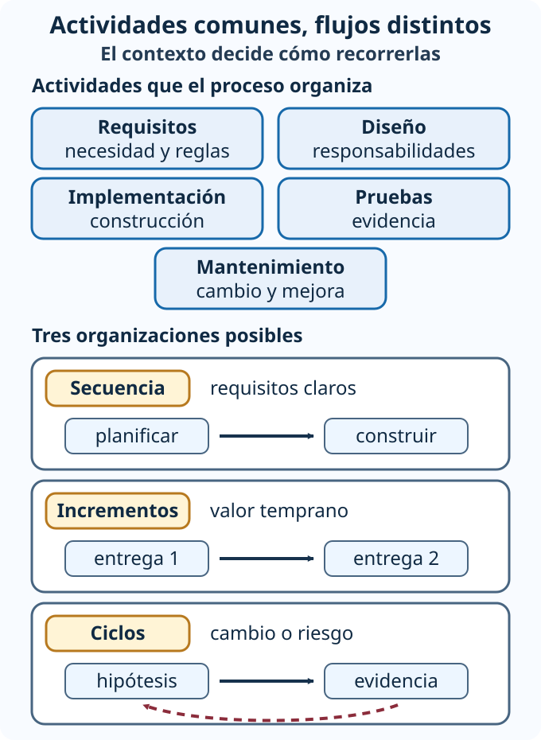

# Procesos de software: actividades, flujo y trabajo reutilizable

**Meta.** Al terminar podrás explicar qué organiza un proceso de software, distinguir
una actividad general de una tarea concreta y representar un flujo sin asumir que
todos los proyectos recorren las actividades una sola vez y en el mismo orden
[@blackboard-arq-s2].

## Objetivos de aprendizaje

- Relacionar requisitos, diseño, implementación, pruebas y mantenimiento con un
  resultado observable.
- Explicar cómo el flujo ayuda a organizar trabajo, avance y comunicación.
- Distinguir tareas específicas de patrones reutilizables sin convertirlos en una
  receta universal.

**Pregunta de recuperación.** Si un equipo programa antes de aclarar quién puede
reservar una sala, ¿qué información faltante podría obligarlo a rehacer el trabajo?

## Un proceso organiza el trabajo, no reemplaza el criterio

Un **proceso de software** ofrece una forma explícita de organizar actividades para
construir y mejorar un producto. Permite conversar sobre qué se intenta conseguir,
qué trabajo está pendiente, qué resultado pasa a la actividad siguiente y cómo se
comprobará. No garantiza calidad por sí solo: un proceso ordenado también puede
producir una solución equivocada si parte de requisitos mal comprendidos o si no
incorpora evidencia.

La fuente oficial presenta cinco actividades generales. Sus nombres permiten ubicar
el trabajo, pero no obligan a ejecutarlas siempre como una cadena rígida. El modelo
de proceso y el contexto determinan si se recorren una vez, por incrementos o en
ciclos con retroalimentación y análisis de riesgos.

::: {.table-responsive tabindex="0" role="region" aria-label="Actividades generales del proceso de software"}

| Actividad | Pregunta que orienta | Resultado de trabajo posible |
|---|---|---|
| Análisis de requisitos | ¿Qué necesidad, regla y restricción debe atenderse? | requisitos aclarados y criterios observables |
| Diseño | ¿Cómo se distribuirán responsabilidades, datos e interfaces? | decisiones y esquema de solución |
| Implementación | ¿Cómo se construirá el comportamiento acordado? | software integrado en un alcance definido |
| Pruebas | ¿Qué evidencia confirma o contradice lo esperado? | resultados, defectos y decisiones de corrección |
| Mantenimiento | ¿Qué debe corregirse, adaptarse o mejorarse después de usarlo? | cambios controlados y nueva evidencia |

:::

Estas actividades se influyen mutuamente. Una prueba puede revelar que el requisito
era ambiguo; una restricción descubierta durante la implementación puede llevar a
revisar el diseño; el mantenimiento puede iniciar otro ciclo de análisis. Decir que
existe una secuencia lógica ayuda a coordinar, pero no demuestra que toda actividad
termine para siempre antes de comenzar otra.

## Flujo: hacer visible cómo avanza el trabajo

El **flujo de proceso** describe cómo se relacionan y recorren las actividades. Su
utilidad es práctica: ayuda a organizar tareas, controlar el avance, coordinar la
comunicación del equipo y reducir errores o retrasos evitables. Para que esa ayuda
sea real, el flujo debe mostrar resultados y condiciones de paso, no solo nombres de
fases.

{fig-alt="Diagrama accesible. En la parte superior aparecen cinco actividades disponibles: requisitos, diseño, implementación, pruebas y mantenimiento. Debajo se muestran tres organizaciones posibles, no una receta única: secuencia planificada cuando los requisitos son estables; incrementos funcionales con entrega y aprendizaje; y ciclos con retroalimentación o análisis de riesgos."}

*Figura.* Las actividades pueden ser comunes, pero el recorrido depende del modelo y
del contexto. Las flechas inferiores representan organizaciones alternativas; no
indican que todos los proyectos deban usar simultáneamente los tres recorridos.

### Del nombre de una fase a una condición observable

Imagina un tablero con una columna llamada «Pruebas». Mover una tarjeta allí no
prueba que el sistema funcione. Una condición más útil sería: «la reserva de una sala
ocupada es rechazada y no crea un registro activo». Así el equipo sabe qué evidencia
buscar y puede comunicar por qué la tarea avanza, vuelve a diseño o necesita aclarar
un requisito.

Un flujo también debe reconocer esperas y devoluciones. Si la biblioteca no ha
definido cuánto tiempo conserva una reserva provisional, implementar un temporizador
no elimina la duda. El trabajo debe regresar a la conversación de requisitos con una
pregunta concreta, registrar la decisión y después actualizar diseño, código y prueba.

## Tareas y patrones: distinto nivel de reutilización

Una **tarea** es una actividad específica que se ejecuta en el trabajo, como diseñar
una interfaz, programar un módulo, realizar una prueba o corregir un defecto. Debe
poder describirse con una entrada, una acción y un resultado. «Mejorar el sistema» es
demasiado amplio; «comprobar que una reserva vencida libera la sala» permite revisar
qué se hizo.

Un **patrón**, en el alcance verificado de esta semana, es una solución reutilizable
para un problema común de diseño o desarrollo. Su valor está en reconocer una forma
de resolver problemas recurrentes, favorecer la organización, reutilizar conocimiento
y facilitar mantenimiento u optimización. No significa copiar una plantilla sin
analizar consecuencias. Esta lectura no introduce un catálogo de patrones ni atribuye
al contenido oficial un framework específico.

::: {.table-responsive tabindex="0" role="region" aria-label="Tareas y solución reutilizable en reservas de biblioteca"}

| Elemento | Ejemplo en reservas de biblioteca | Comprobación |
|---|---|---|
| Tarea de diseño | definir la interfaz para consultar disponibilidad | la interfaz expresa entradas, resultado y errores relevantes |
| Tarea de implementación | programar la regla que evita dos reservas activas | el comportamiento se integra en el incremento acordado |
| Tarea de prueba | intentar reservar una sala ya ocupada | se obtiene rechazo y no se altera la reserva existente |
| Corrección de defecto | impedir que una reserva vencida siga bloqueando el horario | una prueba reproduce el fallo antes y confirma la corrección después |
| Solución reutilizable | separar la regla de disponibilidad de la pantalla | se reutiliza la idea solo cuando el problema y sus consecuencias coinciden |

:::

## Caso guiado: primer flujo para reservar salas

Una red de bibliotecas quiere permitir que estudiantes consulten y reserven salas de
estudio. Hoy cada sede lleva una hoja distinta. La primera entrega debe servir en una
sede piloto; todavía no se ha decidido si las reservas podrán modificarse desde una
aplicación móvil.

### 1. Aclarar el alcance inicial

El equipo formula una regla verificable: una sala no puede tener dos reservas activas
en el mismo horario. También registra una incertidumbre: los cambios desde móvil no
forman parte del primer alcance y deberán confirmarse con quienes usan el servicio.
Eso evita diseñar una solución completa para un requisito aún no observado.

### 2. Relacionar actividades y resultados

1. **Requisitos:** identificar persona, sala, horario y regla de exclusión.
2. **Diseño:** separar consulta de disponibilidad y registro de reserva.
3. **Implementación:** construir consulta y creación para una sede piloto.
4. **Pruebas:** comprobar horario libre, horario ocupado y datos inválidos.
5. **Mantenimiento:** registrar defectos y cambios aprendidos durante el piloto.

La lista describe relaciones lógicas, no una prohibición de volver atrás. Si la prueba
revela que dos solicitudes simultáneas se confirman, el equipo revisa diseño e
implementación. Si las personas no entienden el estado «provisional», vuelve a
requisitos y lenguaje de la interfaz.

### 3. Hacer visible el avance

Cada resultado tiene una condición de revisión. Un requisito avanza cuando incluye
una regla y un ejemplo; el diseño, cuando muestra quién protege esa regla; la
implementación, cuando integra un alcance ejecutable; la prueba, cuando registra el
resultado; y el mantenimiento, cuando un cambio conserva la razón y la evidencia.
El flujo mejora la comunicación porque el equipo puede explicar qué falta sin usar
«casi terminado» como estado impreciso.

::: {.callout-note collapse="true" title="Retroalimentación del caso guiado"}
Una respuesta razonable no necesita dibujar cinco cajas en línea. Podría organizar
el piloto como un incremento y repetir análisis, diseño, implementación y pruebas
para la siguiente capacidad. Lo importante es que la organización conserve la regla,
muestre resultados y permita aprender. Elegir el modelo se estudia en la lectura
siguiente.
:::

## Práctica breve: del trabajo difuso a tareas revisables

Para el mismo caso, el equipo escribe «hacer notificaciones» y «probar reservas».
Reformula ambos elementos como tareas con entrada, acción y resultado. Después indica
qué decisión debe volver a requisitos si aún no está definida.

::: {.callout-tip collapse="true" title="Pista opcional"}
Separa el medio de notificación de la regla que decide cuándo se envía. En pruebas,
especifica una condición y un resultado; no uses «probar todo».
:::

::: {.callout-note collapse="true" title="Una solución posible"}
**Tarea 1:** dada una reserva confirmada y un correo válido, preparar un aviso con
sede, sala y horario; el resultado es un mensaje listo para enviar. **Tarea 2:** dada
una sala con una reserva activa en un horario, solicitar el mismo intervalo; el
resultado esperado es rechazo sin un segundo registro. Debe volver a requisitos la
decisión sobre qué ocurre si el envío del aviso falla: la reserva podría seguir
confirmada, quedar pendiente o requerir otra política. Esa regla no se deduce del
nombre de la tarea.
:::

## Cierre

Un proceso aporta lenguaje para organizar trabajo y evidencia. Las actividades
generales ayudan a ubicar decisiones; el flujo explica cómo avanzan, se comunican o
regresan; las tareas convierten intención en trabajo revisable; y los patrones permiten
reutilizar soluciones cuando el problema y sus consecuencias son comparables. La
siguiente lectura usa estas bases para contrastar modelos sin declarar uno
universalmente superior.
